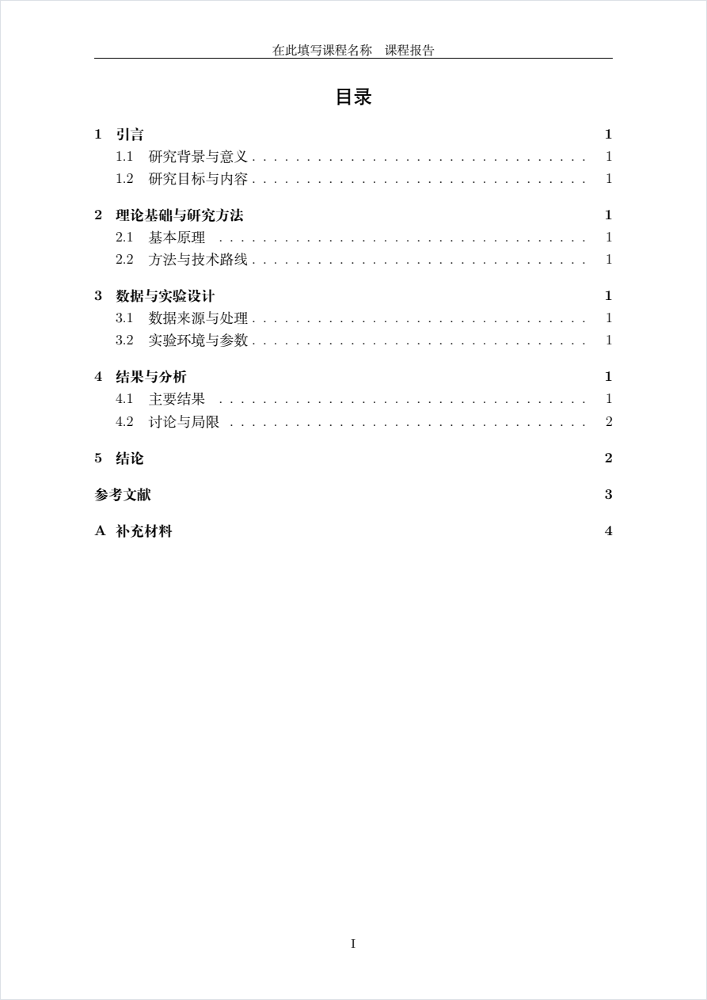
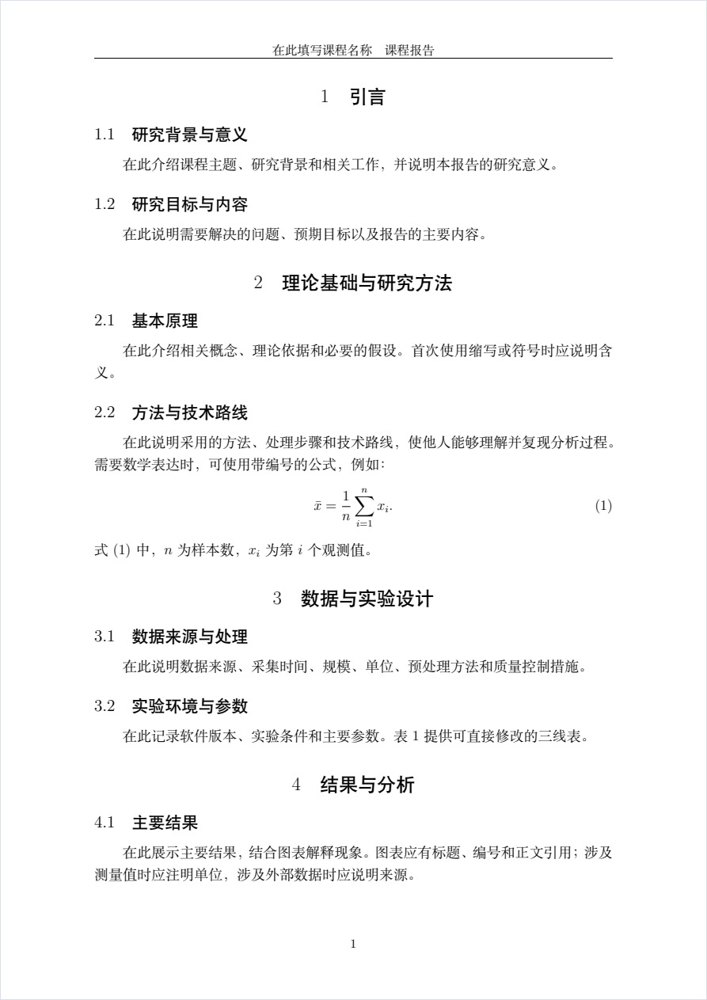
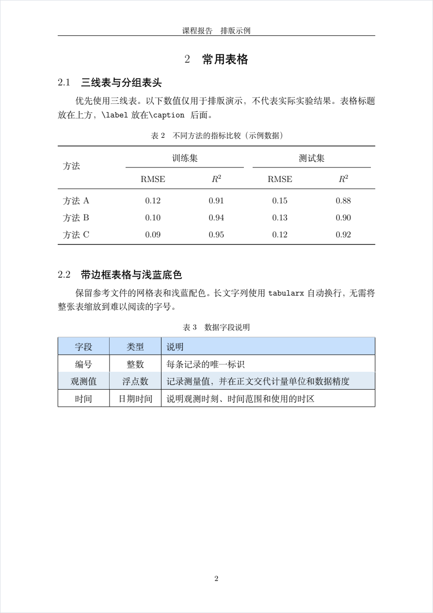
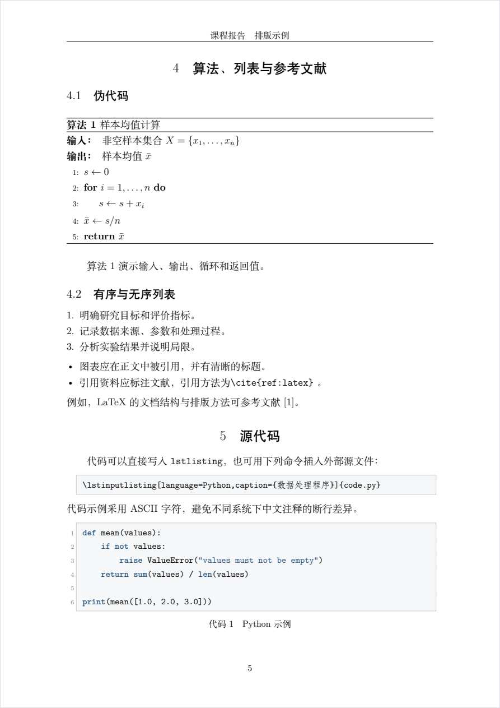
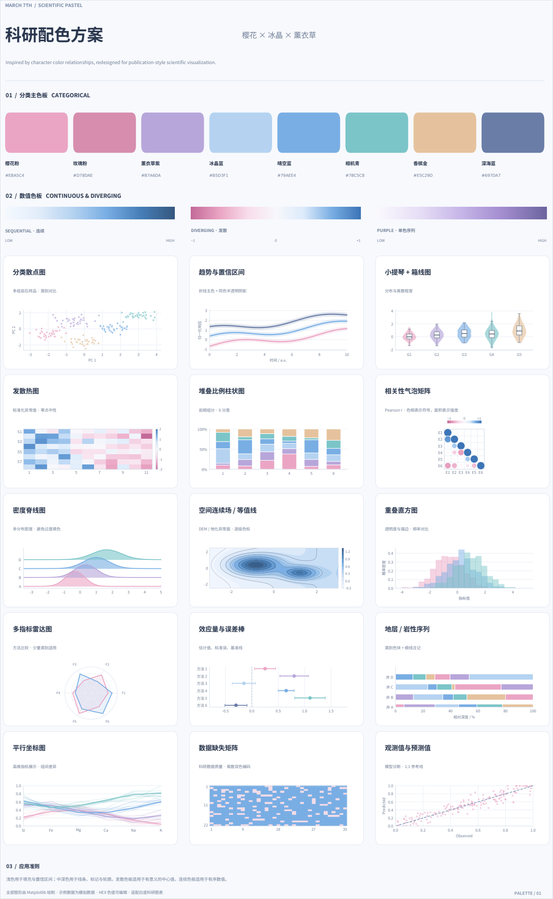
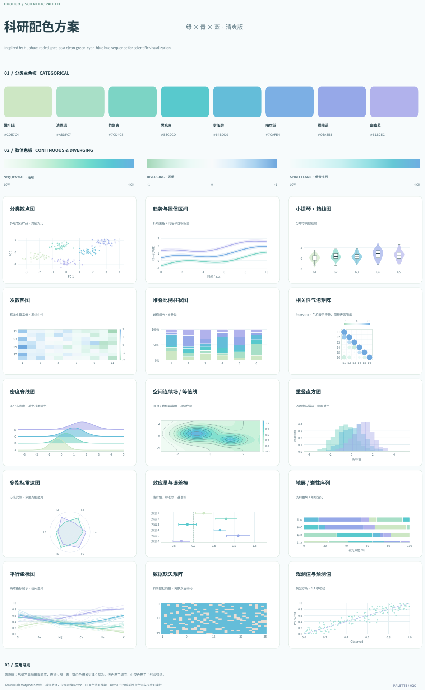
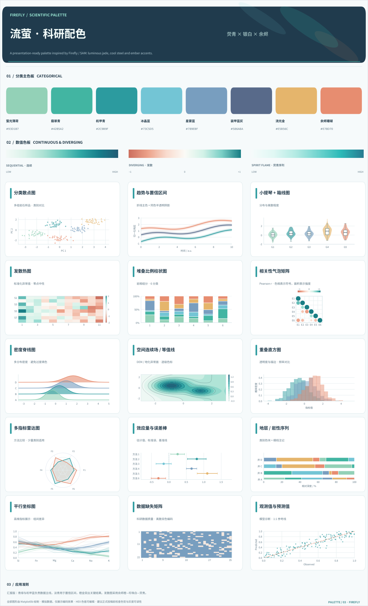

# 通用中文课程报告 LaTeX 模板

> 专为高校课程论文、实验报告、大作业与课程设计打造的轻量级开箱即用 LaTeX 模板。
> 页面优雅规范，零外部图片依赖即可直接编译；预置丰富排版模块，并附赠 3 款高颜值科研绘图配色方案。

---

## 模板效果预览

### 1. 报告整体版式
模板遵循学术报告视觉标准，目录采用大写罗马页码，正文从阿拉伯数字 1 重新起编，并配备规范的页眉页脚与层次清晰的标题字阶。

| 目录页排版（TOC） | 正文主体排版（Main Body） |
| :---: | :---: |
|  |  |

### 2. 学术表格与算法代码
预置规范学术三线表（含跨列多级表头）、雅致浅蓝底色网格表，以及规范的算法伪代码和带语法高亮、行号的代码展示块。

| 常用学术表格（三线表 / 浅蓝底色表） | 算法伪代码与源代码高亮 |
| :---: | :---: |
|  |  |

---

## 附科研绘图配色方案

为方便在课程报告与学术论文中绘制高水准的数据插图，仓库在 [`plotcolor/`](plotcolor/) 文件夹中配套了 3 套**科研配色看板**。

该配色体系灵感参考了《崩坏：星穹铁道》中角色（三月七、藿藿、流萤）的色彩搭配关系，并针对白底学术论文、屏幕汇报展示与打印可读性进行了专门的色相阶梯与明暗对比重构优化（**注：本配色专为科研可视化设计，并非游戏角色的原始色值**）。

每套方案均提供分类色板（Categorical）、连续色板（Sequential）、发散色板（Diverging）以及 12 种常见学术图表（散点、热图、雷达图、箱线图等）的应用示例：

| 三月七 · 樱花冰晶 (Pastel) | 藿藿 · 绿青蓝 (Clean Gradient) | 流萤 · 荧青余烬 (Ember & Jade) |
| :---: | :---: | :---: |
| <a href="plotcolor/march7_scientific_palette.pdf"></a> | <a href="plotcolor/huohuo_scientific_palette.pdf"></a> | <a href="plotcolor/firefly_scientific_palette.pdf"></a> |
| [查看矢量 PDF](plotcolor/march7_scientific_palette.pdf) · [高清图](plotcolor/march7_scientific_palette.png) | [查看矢量 PDF](plotcolor/huohuo_scientific_palette.pdf) · [高清图](plotcolor/huohuo_scientific_palette.png) | [查看矢量 PDF](plotcolor/firefly_scientific_palette.pdf) · [高清图](plotcolor/firefly_scientific_palette.png) |

### 色板色值速查 (HEX)

#### 三月七 (March 7th · 樱花冰晶)
> 参考三月七角色色系优化。粉紫与冰蓝基调柔和温润，对比清晰且不刺眼，极佳适配白底图表与多类别对比。

| 颜色名称 | 樱花粉 | 玫瑰粉 | 薰衣草紫 | 冰晶蓝 | 晴空蓝 | 相机青 | 香槟金 | 深海蓝 |
| :--- | :---: | :---: | :---: | :---: | :---: | :---: | :---: | :---: |
| **HEX** | `#EBA5C4` | `#D78DAE` | `#B7A6DA` | `#B5D3F1` | `#79AEE4` | `#7BC5C8` | `#E5C29D` | `#697DA7` |

#### 藿藿 (Huohuo · 绿青蓝)
> 参考藿藿角色色系优化。绿至青蓝的自然色相渐进，层次细腻通透，极适合时序变化、连续物理场、热图与等值线。

| 颜色名称 | 嫩叶绿 | 清露绿 | 竹影青 | 灵息青 | 岁阳碧 | 晴空蓝 | 雾岭蓝 | 幽夜蓝 |
| :--- | :---: | :---: | :---: | :---: | :---: | :---: | :---: | :---: |
| **HEX** | `#CDE7C4` | `#A8DFC7` | `#7CD4C5` | `#58C9CD` | `#64BDD9` | `#7CAFE4` | `#96A8E8` | `#B1B2EC` |

#### 流萤 (Firefly · 荧青余烬)
> 参考流萤角色色系优化。机甲冷青搭配余烬暖色，科技感鲜明，特别适合突出关键实验组、发散差异及置信区间。

| 颜色名称 | 荧光薄荷 | 翡翠青 | 机甲青 | 冰晶蓝 | 星雾蓝 | 装甲蓝灰 | 流光金 | 余烬珊瑚 |
| :--- | :---: | :---: | :---: | :---: | :---: | :---: | :---: | :---: |
| **HEX** | `#93D1B7` | `#42B5A2` | `#2C9B9F` | `#73C5D5` | `#789EBF` | `#586A8A` | `#E5B56C` | `#E78D70` |

> [!TIP]
> **在 Python (Matplotlib) 中一键使用：**
> ```python
> import matplotlib.pyplot as plt
>
> # 以流萤配色为例设置默认颜色循环
> firefly_colors = ["#42B5A2", "#2C9B9F", "#73C5D5", "#E5B56C", "#E78D70", "#586A8A"]
> plt.rcParams["axes.prop_cycle"] = plt.cycler(color=firefly_colors)
> ```

### 模板内置文档强调色
模板在 `course-report.sty` 中同样预设了雅致的学术点缀色，用于表格与代码块：
- **表头高亮 (`TableHead`)**：`#C7E0FC`（柔和浅蓝）
- **斑马纹底色 (`TableStripe`)**：`#E0EBF5`（清淡雾蓝）
- **代码背景 (`CodeBackground`)**：`#F5F7F9`（淡雅灰白）
- **代码关键字 (`CodeKeyword`)**：`#26547C`（沉稳深蓝）
- **代码注释 (`CodeComment`)**：`#596A5F`（素雅墨绿）

---

## 快速上手

仅需三步即可完成一篇规范美观的课程报告：

### 1. 修改基本信息
打开 `main.tex`，在文件开头的配置区填入你的课程与报告信息：

```latex
\renewcommand{\ReportTitle}{基于深度学习的图像分类实验研究}  % 报告题目
\renewcommand{\ReportType}{课程报告}                      % 报告类型（实验报告 / 课程论文 / 课程设计）
\renewcommand{\CourseName}{模式识别与机器学习}            % 课程名称（显示于页眉）
\renewcommand{\StudentName}{张三}                        % 姓名（写入 PDF 元数据）
```

### 2. 撰写正文与调用模块
- **正文写作**：直接在 `main.tex` 的预设框架（引言、理论、实验设计、结果分析、结论）下填充内容。
- **查找示例**：打开配套的 `examples.tex`，里面提供了数学公式、三线表、多子图、算法伪代码、代码块等多种成熟模块，复制所需代码段直接粘贴到 `main.tex` 即可使用。

### 3. 编译成稿
请使用 **XeLaTeX** 编译器编译。为确保目录生成与交叉引用正确，建议**完整编译两次**。

**命令行编译：**
```powershell
xelatex -interaction=nonstopmode -halt-on-error main.tex
xelatex -interaction=nonstopmode -halt-on-error main.tex
```

若配置了 `latexmk`，可一条命令自动处理多轮编译：
```powershell
latexmk -xelatex main.tex
```

**编辑器与 Overleaf 设置：**
- **VS Code / TeXstudio / TeXworks**：将默认编译器切换为 `XeLaTeX`。
- **Overleaf 在线编译**：打包上传所有 `.tex` 和 `.sty` 文件，在项目设置（Menu -> Compiler）中将编译器更改为 `XeLaTeX` 即可。

---

## 文件结构与用途

```text
├── main.tex             # 报告主文件，实际写作入口（含标准骨架、参考文献、附录）
├── course-report.sty    # 样式配置文件，统一管控页边距、字阶、页眉页脚、表格与代码样式
├── examples.tex         # 综合排版示例手册，包含各类图表、公式、算法环境代码，可独立编译
├── output/
│   └── pdf/
│       ├── main.pdf     # main.tex 编译后的样例 PDF
│       └── examples.pdf # examples.tex 编译后的示例手册 PDF
├── plotcolor/           # 附赠科研绘图配色库（含三月七、藿藿、流萤高清 PNG 与矢量 PDF）
└── assets/              # README 展示预览截图
```

---

## 常见修改与定制技巧

### 1. 结构与内容微调
- **不需要目录**：在 `main.tex` 中注释掉 `\MakeReportContents` 这一行。
- **需要中文摘要**：在 `\MakeReportContents` 之后、`\StartReportBody` 之前加入 `reportabstract` 环境：
  ```latex
  \begin{reportabstract}
    本报告探讨了……
    \keywords{深度学习；图像分类；卷积神经网络}
  \end{reportabstract}
  ```
- **转换为实验报告**：将 `\ReportType` 改为 `实验报告`，正文小节调整为：实验目的、实验原理、设备与环境、实验步骤、实验结果与分析、总结讨论。
- **多人小组报告**：在 `\StudentName` 中用顿号或空格隔开多人姓名，例如 `张三、李四、王五`。
- **去除附录**：直接删除 `\appendix` 及其后面的章节内容。

### 2. 格式与排版定制
- **切换为 Windows 字体**：模板默认使用跨平台的开源 `Fandol` 字体。若学校要求中文字体严格对应 Windows 本地宋体/黑体，可将 `main.tex` 与 `examples.tex` 第一行的 `fontset=fandol` 改为 `fontset=windows`。
- **修改页眉文字**：可在导言区重定义页眉：
  ```latex
  \renewcommand{\ReportHeader}{自定义页眉内容}
  ```
- **公式与图表按节编号**：默认图、表、公式全文连续编号（如 图 1，表 1）。如需按章节编号（如 图 2.1，式 3.2），只需在导言区加入：
  ```latex
  \numberwithin{equation}{section}
  \numberwithin{figure}{section}
  \numberwithin{table}{section}
  ```
- **插入实际图片**：将你的图片保存在根目录或自建的 `figures/` 文件夹中，使用 `\includegraphics[width=0.8\linewidth]{图片文件名}` 插入。

---

## 常见问题排查 (FAQ)

### Q1: 编译后目录是空的，或者引用处显示为 `??`？
**解答**：LaTeX 生成目录和交叉引用需要两轮扫描。请多运行一次 `xelatex` 编译即可恢复正常。

### Q2: 编译时提示 `Please compile with XeLaTeX` 错误？
**解答**：本模板为中文文档，依赖 XeLaTeX 处理中文字体。请在编辑器（如 VS Code、TeXstudio）或 Overleaf 设置中将编译器由默认的 `pdfLaTeX` 改为 `XeLaTeX`。

### Q3: 表格内容过长导致超出页面右边缘？
**解答**：避免对长文本列使用固定宽度 `p{...}`，推荐使用模板中提供的 `tabularx` 及其自适应列格式：
- `L`：靠左对齐，宽度自适应并自动换行。
- `C`：居中对齐，宽度自适应。
- `R`：靠右对齐，宽度自适应。

### Q4: 跨页长表排版异常？
**解答**：长表格请使用 `longtable` 环境（参见 `examples.tex` 第 2.4 节），注意 `longtable` **不能**嵌套在 `table` 浮动体内，应直接放置在正文文本流中。

---

## 授权与许可

本项目采用 MIT 许可证开源，欢迎在课程学习、实验报告与科研工作中自由使用、修改与分享。
